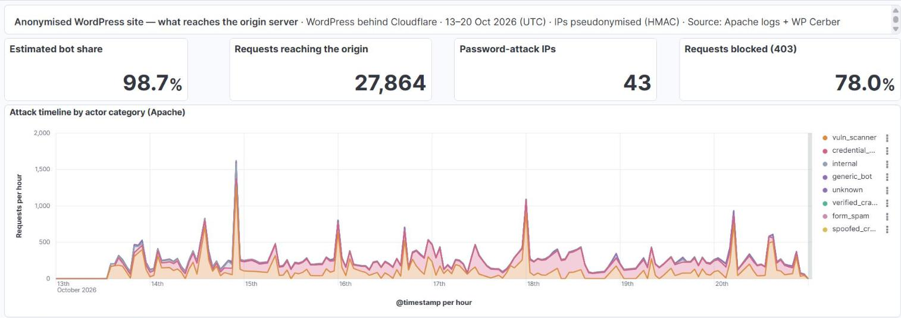
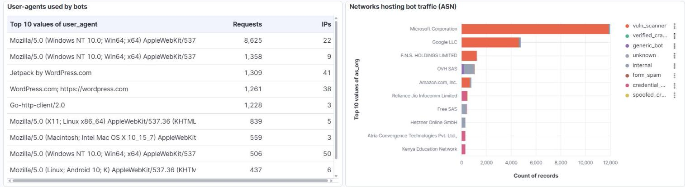
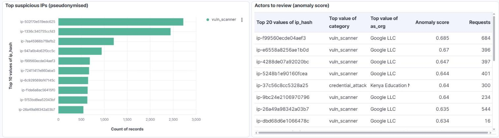
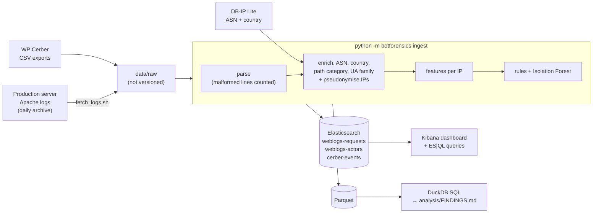

# wp-bot-forensics

[](https://github.com/SimonNC/wp-bot-forensics/actions/workflows/ci.yml)


**Bot fraud investigation on real attack traffic, by Simon Jorite, former fraud analyst
(Fia-Net, BetClic).** One week of production logs from a small business's WordPress site,
analysed end to end: who attacks it, how to prove it, and how good the detection is.
Python, SQL, Elasticsearch and Kibana. [LinkedIn](https://www.linkedin.com/in/simonjorite/)

**Short on time? Read the one-page [threat report](REPORT.md).**

> Built with Claude Code: I drove the investigation, chose the rules and thresholds, and
> validated the results by hand.



## What I found

In one week (13–20 Oct 2026), 27,864 requests from 863 IP addresses reached the origin
server. An estimated **98.7 % were automated** and 78 % were refused with a 403.

- **Password attacks from a residential proxy network** (account takeover attempts).
  43 IPs on consumer and mobile ISPs in 21 countries, none in a datacenter, sent 5,160
  `POST /xmlrpc.php` login attempts. 39 of them posed as WordPress.com's Jetpack service;
  none came from its network. A typical IP fires ~56 attempts per 10 minutes, and 25 of
  them stop at exactly 150: a per-bot quota, the fingerprint of one tool.
- **Scanners disguised as AI and search crawlers.** 6 Google Cloud IPs, on 4 different
  days, each rotated the same 33 user-agents (24 crawler names: GPTBot, ClaudeBot,
  PerplexityBot, DeepSeekBot, GrokBot, Googlebot…) while hunting for `.env` files and
  cloud credentials: 2,513 requests, most IPs firing ~400 in 12–14 seconds. This is not AI agent
  traffic, it is a secrets scanner wearing crawler masks, probably to slip through
  "allow AI crawlers" rules. Nothing sensitive was served.
- **Vulnerability scanning from the public cloud.** 159 IPs, 71 % of all requests, 83 % of
  that volume from Microsoft and Google cloud networks.
- **Each defence layer sees a different slice.** Apache refused all 5,189 XML-RPC POSTs
  (403) before WordPress ran; the WordPress security plugin (WP Cerber) logged only 14
  XML-RPC refusals.
  Reading one layer only would miss the attack almost entirely.

**Detection quality.** On 30 actors reviewed by hand, the rules agree with my verdict on
25: when a rule flags a bot it is right 24 times out of 25, but 4 of the 5 actors left as
`unknown` were bots. Precision is high, recall is the weak spot (see
[Validation](#validation)).

## Results

All figures are generated by `python -m botforensics report` into
[`analysis/FINDINGS.md`](analysis/FINDINGS.md); none are typed by hand.

| Category | Actors (IPs) | Requests | Share of requests |
|---|---:|---:|---:|
| `vuln_scanner` | 159 | 19,833 | 71.2 % |
| `credential_attack` | 43 | 5,160 | 18.5 % |
| `internal` | 32 | 1,576 | 5.7 % |
| `generic_bot` | 298 | 769 | 2.8 % |
| `unknown` | 242 | 352 | 1.3 % |
| `verified_crawler` | 83 | 118 | 0.4 % |
| `form_spam` | 3 | 53 | 0.2 % |
| `spoofed_crawler` | 3 | 3 | 0.0 % |

The bot share (98.7 %) excludes `internal` traffic (own monitors and admin sessions).



**Password attacks.** The 43 IPs are spread over 34 ISPs (Reliance Jio, Atria Convergence,
Bharti Airtel, Kenya Education Network, AXS Bolivia…); most alternate between two
Jetpack-like user-agents. Their timing is almost constant (median coefficient of variation
0.05), the signature of a scripted loop. Without the request bodies, the logs cannot tell
whether the passwords come from leaked lists (credential stuffing) or a dictionary (brute
force). Only 10 of the 43 overlap in time on the same target with two other IPs, so the
per-IP burst rule does most of the work, not the campaign rule.

**Disguised scanners.** The six IPs share one tool: same 33 user-agents, near-identical
response counts (four of them got exactly 219 × 403 and 176–177 × 404), targets such as
`/.env`, `/.env.production`, `/@fs/.env` and `/api/proc/self/environ`. My classifier labels
them `vuln_scanner`, because attack rules run before identity checks; a dedicated table
in `FINDINGS.md` keeps the spoofing visible. Coming from Google Cloud, their `Googlebot`
user-agent would have passed my ASN-based crawler check: this is the main limit of the
current verification (see [Limits](#limits)).

**Scanners.** One frozen `Chrome/120` user-agent carries 8,625 bot requests from 22 IPs,
and 3,300 bot requests have no user-agent at all: typical of kits that never update their
headers.

**Rules vs. WP Cerber.** Cerber locked out or flagged 92 of the 159 scanners, but none of
the 43 password attackers, because Apache answers them first.



## Validation

Real logs have no ground truth, so the classifier is checked three ways.

1. **Manual review of 30 actors**, sampled by category (`python -m botforensics review`,
   labels in [`analysis/review_sample.csv`](analysis/review_sample.csv)). The rules agree
   with my verdict on **25/30**. The sample is stratified, so read the agreement per
   category: it measures each rule's precision, not overall accuracy.

   | Rule category | Agree / reviewed | Disagreement |
   |---|---|---|
   | `credential_attack`, `spoofed_crawler`, `form_spam`, `verified_crawler`, `generic_bot` | 20 / 20 | — |
   | `vuln_scanner` | 4 / 5 | A verified bingbot followed one link to a sensitive path: crawler, not scanner |
   | `unknown` | 1 / 5 | Four bots missed: `AhrefsSiteAudit` (×2, no "bot" in its name), a Palo Alto Networks internet scanner, a truncated user-agent |

   The limits of this check: one annotator, who also wrote the rules, and recall is not
   measured. A second annotator and a recall sample drawn from `unknown` are the next step.

2. **A false positive found and fixed.** Before my own IPs were allowlisted, my admin
   sessions (up to 45 requests/minute) were classified `generic_bot` and an SEO audit tool
   I ran was classified `vuln_scanner`. Both are now `internal`: "fast and from one IP" is
   not "malicious".

3. **Cross-checks** with the server's 403 rate and with Cerber's verdict per IP (tables in
   [`analysis/FINDINGS.md`](analysis/FINDINGS.md)).

**Isolation Forest: exploratory.** An anomaly detector scores every actor to suggest new
rules. It mostly confirms what the rules already catch, and it flagged none of the
`unknown` actors (the "rule gaps" table is empty): one or two requests carry too little
behaviour to score. It never overrides a rule.

## Limits

- **Origin logs only.** No TLS fingerprint, no JavaScript signal, no header order: a
  headless Chrome with a consistent user-agent behind a residential proxy would look
  human here. Those signals live at the edge, before the origin.
- **Biased vantage point.** The site sits behind a CDN (Cloudflare) that caches pages, so
  few humans reach the origin: 98.7 % describes the origin, not the site's audience.
- **Crawler verification relies on the network owner only.** A Google Cloud VM is also
  "Google LLC", as the disguised scanners show.
- **Declared-bot detection depends on keywords.** Names without "bot", "spider" or
  "crawler" (`AhrefsSiteAudit`) are missed.
- **Campaigns are keyed on the target.** On a busier site, a burst of legitimate logins
  could look like a campaign.
- **One week, one site.** Thresholds are tuned on 27,864 requests and need checking on
  other traffic.
- **"Outdated Chrome" uses a fixed version** (`CURRENT_CHROME_MAJOR`) to bump on later logs.

## How it works



- **Unit of analysis: the IP address.** Scanners rotate user-agents, so (IP, user-agent)
  sessions would split one actor into many.
- **Two indexes, as in a SOC:** one document per request (events) and one per IP
  (entities, with category, reasons and scores).
- **SQL twice:** DuckDB for versioned, reproducible queries that run in CI without a
  cluster; ES|QL ([`analysis/esql/`](analysis/esql/)) for investigation in Kibana.

Rules run in order and the first match wins. Each verdict keeps its reasons, for example
`declared=Jetpack; Jetpack_from=Reliance Jio Infocomm Limited; login_posts_10min=56`.

| Order | Category | Main signals |
|---|---|---|
| 1 | `internal` | Operator IPs (allowlist), own uptime monitors and WP-cron, unless an attack signal fires |
| 2 | `credential_attack` | POST bursts on `xmlrpc.php` or the login page; same target hit by ≥ 3 IPs in one hour |
| 3 | `vuln_scanner` | Probes on sensitive paths (`.env`, `.git`, `wp-config`, webshells), high 4xx rate |
| 4 | `spoofed_crawler` | Declared crawler name, but the IP belongs to another network |
| 5 | `form_spam` | Repeated contact-form POSTs, form submissions refused by Cerber |
| 6 | `verified_crawler` | Declared crawler from its operator's network (Googlebot from Google, bingbot from Microsoft) |
| 7 | `generic_bot` | Tool or missing user-agent, outdated browser, machine-like rhythm, unverifiable declared bot |
| 8 | `unknown` | None of the above: probable human |

- **Behaviour beats identity.** A crawler name costs nothing to fake, so attack rules run
  first; the spoofing stays visible in the reasons and in a dedicated table.
- **A datacenter network is evidence, never a verdict.** Monitors, crawlers and VPN users
  live there too.

The full design, with all 13 indicators and their rationale, is in
[`docs/design.md`](docs/design.md).

## Run it

Requirements: Docker Desktop (Elasticsearch uses a 1 GB heap), Python 3.11+.

```bash
git clone https://github.com/SimonNC/wp-bot-forensics.git
cd wp-bot-forensics
python -m venv .venv
source .venv/bin/activate          # Windows: .venv\Scripts\activate
pip install -e ".[dev]"
cp .env.example .env               # Windows: copy .env.example .env
# then set ELASTIC_PASSWORD, KIBANA_PASSWORD and KIBANA_ENCRYPTION_KEY in .env

docker compose up -d                          # Elasticsearch + Kibana, bound to localhost
python -m botforensics ingest data/sample     # parse, classify, index (one public sample day)
python scripts/import_dashboard.py            # data views + dashboard
```

Open http://localhost:5601, sign in as `elastic` with `ELASTIC_PASSWORD`, open the
**Bot traffic - origin view** dashboard and set the time range to 14 Oct 2026. The sample
gives 5,879 requests and 189 actors.

```bash
python -m botforensics ingest data/sample --no-es   # no Elasticsearch needed (used in CI)
python -m botforensics report                       # DuckDB queries → analysis/FINDINGS.md
python -m botforensics esql analysis/esql/xmlrpc_top_attackers.esql
pytest -q && ruff check .
```

## Data and privacy

| Data | Versioned? | How to get it |
|---|---|---|
| One pseudonymised day (14 Oct 2026): Apache log, Cerber events, ASN/country per IP | Yes, [`data/sample/`](data/sample/) | Included |
| Full Apache logs, 13–20 Oct 2026 | No (personal data) | Site owner only: `scripts/fetch_logs.sh` pulls the daily archives over SSH into `data/raw/apache/` |
| WP Cerber activity exports | No (IPs, usernames) | Export the Cerber activity log as CSV from the WordPress admin into `data/raw/cerber/` |
| ASN and country databases | No (licence, size) | `python scripts/download_geo.py` → `data/geo/` |

**Use your own logs.** Any Apache `combined` log works: put the files (`.log` or `.log.gz`)
in `data/raw/apache/`, download the GeoIP databases, set a random `PSEUDO_KEY` and your
`SITE_DOMAIN` in `.env`, and run `python -m botforensics ingest data/raw`. Cerber exports
are optional. [`ops/archive-access-logs.sh`](ops/archive-access-logs.sh) archives a
container's logs daily from cron, since Docker keeps only a few weeks.

**Privacy.** Logs contain personal data, and the site is anonymised:

- IP addresses are replaced by `HMAC-SHA256(secret key, IP)` right after the ASN/country
  lookup. No clear IP reaches Elasticsearch, Parquet, the sample or the screenshots. The
  pipeline refuses to process real logs with the development key.
- The site's domain and name become `site.example` everywhere; e-mail addresses, uploaded
  media names, login usernames and `/author/<name>` paths are masked; query strings are
  dropped.
- The custom login URL is a security secret: it becomes `/<custom-login>/`, including
  percent-encoded variants.
- A test suite checks that the public sample carries none of these.

**Licences.** Code: MIT ([`LICENSE`](LICENSE)). IP to ASN and IP to Country data:
[DB-IP Lite](https://db-ip.com) by DB-IP.com, CC BY 4.0 ([`NOTICE`](NOTICE)).

## Next steps

- Verify crawlers against their operators' published IP ranges and forward-confirmed
  reverse DNS, instead of the AS name.
- Measure recall: a second annotator and a review sample drawn from `unknown`.
- Add a dictionary of known tools and SEO crawlers to close the gap found in the review.
- Fingerprint the attack tools beyond the user-agent (request size, XML-RPC method,
  timing) to follow them when they change disguise.

## Repository layout

```
src/botforensics/   pipeline package (parse, privacy, enrich, features, rules, anomaly, es, report)
analysis/           DuckDB queries, generated FINDINGS.md, review sample, ES|QL queries
kibana/             exported dashboard (11 panels) and data views
scripts/            data download, Kibana import/export
ops/                daily log archive script (cron)
docs/               design document and screenshots
tests/              pytest suite, including checks that the sample leaks nothing
```
