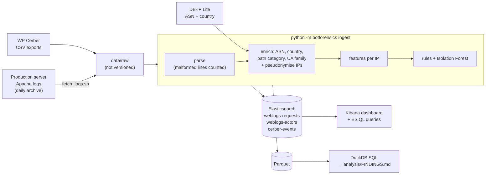

# wp-bot-forensics

Bot detection and classification in **real** web server logs: one week of Apache access
logs from a production WordPress site ([site.example](https://site.example), a small business), cross-checked with its WAF plugin (WP Cerber), indexed in
Elasticsearch and explored in Kibana.


**In one week (13–20 Oct 2026), 27,864 requests from 863 IP addresses reached the origin
server. An estimated 98.7 % of them were automated, and 78 % were refused with a 403.**

- **Credential stuffing by a residential botnet.** 43 IPs on consumer and mobile ISPs in
  21 countries (16 in India), none in a datacenter, sent 5,160 `POST /xmlrpc.php`. Most
  posed as WordPress.com's Jetpack service (`Jetpack by WordPress.com`,
  `WordPress.com; https://wordpress.com`), but none came from Automattic's network.
  A typical IP fires ~56 attempts per 10 minutes, and 25 of them stop at exactly 150:
  a per-bot quota.
- **Vulnerability scanning from the public cloud.** 159 IPs probed for `.env`, `.git`,
  `wp-config` backups and webshells: 71 % of all requests. 83 % of that volume came
  from Microsoft and Google cloud networks.
- **Each defence layer sees a different slice.** Apache rejected 5,189 XML-RPC POSTs
  before PHP ran, while WP Cerber logged only 14 XML-RPC refusals. Looking at one layer
  only would miss the attack almost entirely.
- **Validation.** On a stratified sample of 30 actors, the rules agree with manual review
  on 25. When a rule flags a bot it is right 24 times out of 25, but 4 of the 5 actors
  left as `unknown` were in fact bots: the rules are precise, recall is the weak spot.

## Why this project

Bot-protection vendors see traffic *before* it reaches a site. This project looks at the
other end: what still reaches the origin of a small, real site behind a CDN, who sends
it, and what an analyst can prove from raw logs alone. The method is the one a threat
researcher applies to a new attack pattern: explainable rules first, each verdict stored
with its reasons, an anomaly detector as a safety net, and a manual review to measure
how often the rules are right.

## Architecture



- **Unit of analysis: the IP address.** Scanners rotate user-agents, so (IP, user-agent)
  sessions would split one actor into many.
- **Two indexes, as in a SOC:** one document per request (events) and one per IP (entities,
  with category, reasons and scores).
- **Two query engines:** DuckDB for versioned, reproducible SQL that runs in CI without a
  cluster; ES|QL ([`analysis/esql/`](analysis/esql/)) for interactive investigation in Kibana.

## Classification

Rules run in order and the first match wins. Each verdict keeps its reasons, for example
`declared=Jetpack; Jetpack_from=Reliance Jio Infocomm Limited; login_posts_10min=56`.

| Order | Category | Main signals |
|---|---|---|
| 1 | `internal` | Operator IPs (allowlist), own uptime monitors and WP-cron, unless an attack signal fires |
| 2 | `credential_attack` | POST bursts on `xmlrpc.php` or the login page; same target hit by ≥ 3 IPs in one hour |
| 3 | `vuln_scanner` | Probes on sensitive paths (`.env`, `.git`, `wp-config`, webshells), high 4xx rate |
| 4 | `spoofed_crawler` | Declared crawler name, but the IP belongs to another network |
| 5 | `form_spam` | Repeated contact-form POSTs, form submissions refused by Cerber |
| 6 | `verified_crawler` | Declared crawler from its operator's network (Googlebot from Google, bingbot from Microsoft) |
| 7 | `generic_bot` | Tool or missing user-agent, outdated browser, machine-like rhythm, unverifiable declared bot |
| 8 | `unknown` | None of the above: probable human |

**Behaviour beats identity.** Attack rules run before identity checks, because a crawler
name costs nothing to fake. The botnet above declares "Jetpack"; it is classified
`credential_attack`, and the spoofing stays visible in its reasons.

**A datacenter network is evidence, never a verdict.** It is stored as a reason but never
classifies an actor on its own: legitimate monitors, crawlers and VPN users live there too.

The full design, with all 13 indicators and their rationale, is in
[`docs/design.md`](docs/design.md). An Isolation Forest on log-scaled indicators looks for
`unknown` actors that behave like bots, to suggest new rules; it never overrides a rule.

## Results

All figures are generated by `python -m botforensics report` into
[`analysis/FINDINGS.md`](analysis/FINDINGS.md); none are typed by hand.

| Category | Actors (IPs) | Requests | Share of requests |
|---|---:|---:|---:|
| `vuln_scanner` | 159 | 19,833 | 71.2 % |
| `credential_attack` | 43 | 5,160 | 18.5 % |
| `internal` | 32 | 1,576 | 5.7 % |
| `generic_bot` | 298 | 769 | 2.8 % |
| `unknown` | 242 | 352 | 1.3 % |
| `verified_crawler` | 83 | 118 | 0.4 % |
| `form_spam` | 3 | 53 | 0.2 % |
| `spoofed_crawler` | 3 | 3 | 0.0 % |

The bot share (98.7 %) excludes `internal` traffic.


**Credential stuffing.** The 43 attackers are spread over 34 ISPs (Reliance Jio, Atria
Convergence, Bharti Airtel, Kenya Education Network, AXS Bolivia…) and alternate between
two Jetpack-like user-agents. Their inter-arrival times are almost constant (median
coefficient of variation 0.05), the signature of a scripted loop. Only 10 of the 43 overlap in
time on the same target with two other IPs, so the hourly campaign rule alone would have
caught less than a quarter of them: the per-IP burst rule does most of the work.

**Scanners.** One fixed `Chrome/120` user-agent carries 8,625 bot requests from 22 IPs, and
3,300 bot requests have no user-agent at all. Both are typical of scanning kits that never
update their headers.

**Rules vs. WP Cerber.** Cerber locked out or flagged 92 of the 159 scanners, but none of
the 43 credential attackers: Apache's XML-RPC block answers them first, so Cerber never
sees them. The two layers complement each other instead of overlapping.


## Validation

There is no ground truth in real logs, so the classifier is checked three ways.

1. **Manual review of 30 actors**, sampled by category (`python -m botforensics review`,
   labels in [`analysis/review_sample.csv`](analysis/review_sample.csv)). The rules agree
   with the analyst on **25/30**. The sample is stratified, so read the agreement per
   category: it measures each rule's precision, not overall accuracy.

   | Rule category | Agree / reviewed | Disagreement |
   |---|---|---|
   | `credential_attack`, `spoofed_crawler`, `form_spam`, `verified_crawler`, `generic_bot` | 20 / 20 | — |
   | `vuln_scanner` | 4 / 5 | A verified bingbot followed one link to a sensitive path: crawler, not scanner |
   | `unknown` | 1 / 5 | Four bots missed: `AhrefsSiteAudit` (×2, no "bot" in its name), a Palo Alto Networks internet scanner, a truncated user-agent |

2. **A false positive found and fixed.** Before the operator's IPs were allowlisted, my own
   admin sessions (up to 45 requests/minute) were classified
   `generic_bot` and an SEO audit tool I ran was classified `vuln_scanner`. Both are now
   `internal`, and the episode is a reminder that "fast and from one IP" is not "malicious".

3. **Cross-checks** with the server's 403 rate and with Cerber's own verdict per IP
   (tables in [`analysis/FINDINGS.md`](analysis/FINDINGS.md)).

## Run it

Requirements: Docker Desktop (Elasticsearch uses a 1 GB heap), Python 3.11+.

One-time setup:

```bash
git clone https://github.com/SimonNC/wp-bot-forensics.git
cd wp-bot-forensics
python -m venv .venv
source .venv/bin/activate          # Windows: .venv\Scripts\activate
pip install -e ".[dev]"
cp .env.example .env               # Windows: copy .env.example .env
# then set ELASTIC_PASSWORD, KIBANA_PASSWORD and KIBANA_ENCRYPTION_KEY in .env
```

Then three commands:

```bash
docker compose up -d                          # Elasticsearch + Kibana, bound to localhost
python -m botforensics ingest data/sample     # parse, classify, index (one public sample day)
python scripts/import_dashboard.py            # data views + dashboard
```

Open http://localhost:5601, sign in as `elastic` with `ELASTIC_PASSWORD`, then open the
**Bot traffic - origin view** dashboard and set the time range to 14 Oct 2026. The sample
gives 5,879 requests and 189 actors.

Other commands:

```bash
python -m botforensics ingest data/sample --no-es   # no Elasticsearch needed (used in CI)
python -m botforensics report                       # DuckDB queries → analysis/FINDINGS.md
python -m botforensics esql analysis/esql/xmlrpc_top_attackers.esql
pytest -q && ruff check .                           # 162 tests
```

## Data

| Data | Versioned? | How to get it |
|---|---|---|
| One pseudonymised day (14 Oct 2026): Apache log, Cerber events, ASN/country per IP | Yes, [`data/sample/`](data/sample/) | Included |
| Full Apache logs, 13–20 Oct 2026 | No (personal data) | Site owner only: `scripts/fetch_logs.sh` pulls the daily archives over SSH into `data/raw/apache/` |
| WP Cerber activity exports | No (IPs, usernames) | Export the Cerber activity log as CSV from the WordPress admin into `data/raw/cerber/` |
| ASN and country databases | No (licence, size) | `python scripts/download_geo.py` → `data/geo/` |

**Use your own logs.** Any Apache `combined` log works: put the files
(`.log` or `.log.gz`) in `data/raw/apache/`, download the GeoIP databases, set a random
`PSEUDO_KEY` in `.env`, and run `python -m botforensics ingest data/raw`. Cerber exports are
optional.

**Daily archive.** The server keeps container logs for about three weeks only.
[`ops/archive-access-logs.sh`](ops/archive-access-logs.sh) runs from cron every night and
writes one gzip file per UTC day, catches up missed days, and deletes files after 365 days.

**Privacy.** Logs contain personal data, so:

- IP addresses are replaced by `HMAC-SHA256(secret key, IP)` right after the ASN/country
  lookup. No clear IP reaches Elasticsearch, Parquet, the sample or the screenshots. The
  pipeline refuses to process real logs with the development key.
- Login usernames are hashed the same way, query strings are dropped, and
  `/author/<name>` paths become `/author/<author>`.
- The site's custom login URL is a security secret: it is replaced by `/<custom-login>/`
  everywhere, including percent-encoded variants.
- The site is named with its owner's permission; `SITE_LABEL` in `.env` anonymises it in
  one line.

**Licences.** Code: MIT ([`LICENSE`](LICENSE)). IP to ASN and IP to Country data:
[DB-IP Lite](https://db-ip.com) by DB-IP.com, CC BY 4.0 ([`NOTICE`](NOTICE)).

## Limits

- **Biased vantage point.** Cloudflare caches pages for 30 days, so few humans reach the
  origin: the 98.7 % bot share describes the origin, not the site's audience.
- **Crawler verification relies on the network owner only.** A Google Cloud VM is also
  "Google LLC", so a fake Googlebot rented on GCP would pass as verified.
- **Declared-bot detection depends on keywords.** Names without "bot", "spider" or
  "crawler" (`AhrefsSiteAudit`) are missed, as the manual review showed.
- **Low recall on one-request actors.** The Isolation Forest flagged none of the
  `unknown` actors, yet the review found bots among them: one request carries too little
  behaviour to score.
- **Campaigns are keyed on the target.** On a busier site, a burst of legitimate logins
  could look like a campaign.
- **One week, one site.** The rules are tuned on 27,864 requests; their thresholds need
  checking on other traffic.
- **"Outdated Chrome" uses a fixed version** (`CURRENT_CHROME_MAJOR`) that must be bumped
  when the pipeline runs on later logs.

## Next steps

- Verify crawlers against their operators' published IP ranges and reverse DNS
  (forward-confirmed), instead of the AS name.
- Add a user-agent dictionary of known tools and SEO crawlers to close the gap found in
  the review.
- Fingerprint the botnet beyond the user-agent: request body size, XML-RPC method,
  timing pattern, to follow it if it changes disguise.
- Ingest the Cerber database directly instead of CSV exports, and replay the rules on
  several months of archived logs.
- Run the rules on a public dataset with real human traffic to measure false positives.

## Repository layout

```
src/botforensics/   pipeline package (parse, privacy, enrich, features, rules, anomaly, es, report)
analysis/           DuckDB queries, generated FINDINGS.md, review sample, ES|QL queries
kibana/             exported dashboard (11 panels) and data views
scripts/            data download, Kibana import/export
ops/                daily log archive script (cron)
docs/               design document and screenshots
tests/              pytest suite, including checks that the sample leaks no secret
```
